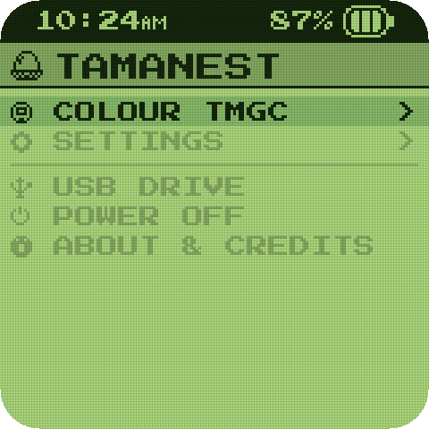
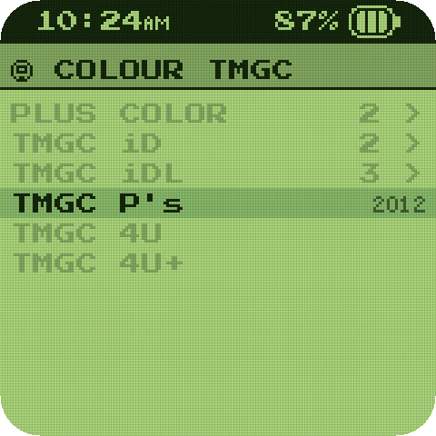
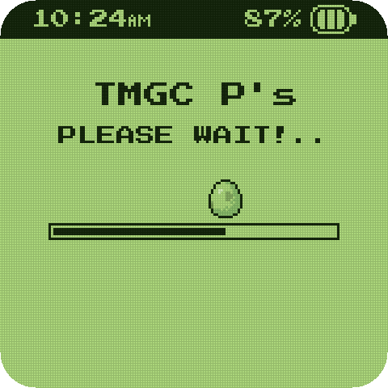
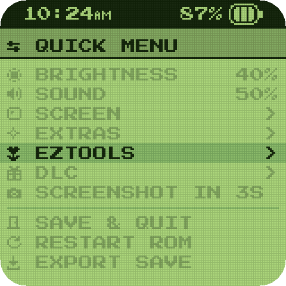
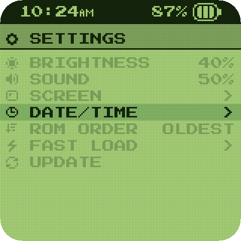
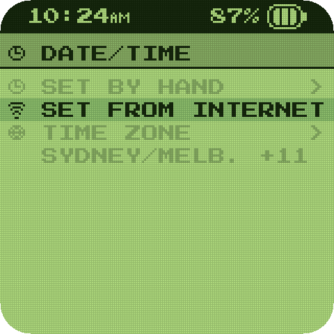

#  TamaNest

A colour Tamagotchi emulator for the **Waveshare ESP32-S3-Touch-AMOLED-2.16**.
TamaNest runs your original toys' firmware (which you dump from toys you own)
so the pet behaves exactly like the real device: same timing, same sounds, same evolutions.

## Screenshots

| | | |
|:-:|:-:|:-:|
|  |  |  |
| Main menu | Game list (editions grouped by toy) | Loading a game |
|  |  |  |
| Quick menu (while playing) | Settings | Date and time |

## Supported Firmwares

| Toy | Status |
|---|---|
| Tamagotchi Plus Color | Full speed, custom status bars, EZTOOLS |
| Hexagontchi (Plus Color edition) | Full speed |
| Tamagotchi iD | Full speed |
| Tamagotchi iD Lovely Melody ver. | Full speed (the rhythm arcade game slows down) |
| Tamagotchi iD L, incl. 15th Anniversary and Princess Spacy ver. | Full speed, custom status bars, EZTOOLS |
| Tamagotchi P's | Full speed, custom status bars, EZTOOLS |
| Tamagotchi 4U | Playable, but needs further optimisation before it is perfect; custom status bars, EZTOOLS |
| Tamagotchi 4U+ | Playable, but needs further optimisation before it is perfect; custom status bars, EZTOOLS |

English and Japanese dumps both work. Special editions are recognised automatically when they are known.

> **Untested versions:** a firmware version that has not been tested and optimised yet will run, but it is likely to
> be slow in busy scenes (TamaNest shows a note the first time). Please open an issue or a request on
> https://github.com/WavieGotchi/TamaNest so it can be added.

> **Other devices:** TamaNest currently runs on the Waveshare ESP32-S3-Touch-AMOLED-2.16 only. If you would like
> support for another ESP32-S3 device, please open a request (issue) on https://github.com/WavieGotchi/TamaNest.

## What you need

- A Waveshare ESP32-S3-Touch-AMOLED-2.16 (with its battery).
- A microSD card, **8–32 GB, formatted FAT32** ("MS-DOS (FAT)" on a Mac). Bigger cards come as exFAT and are not read.
- The ROM files of your own toys (`.bin`). TamaNest does not include any ROMs.

## Installing

1. Open the TamaNest installer page, https://waviegotchi.github.io/TamaNest, in **Chrome or Edge** on a computer, or in
   **Chrome on an Android phone or tablet** (connected with a USB-C cable or adapter).
2. Connect your device with a USB-C data cable and press **INSTALL / UPDATE**.
3. First install: select the erase.

Later updates: do NOT select erase — settings, saves, and your ROMs will not be erased.

## SD card

```
roms/          your ROMs (.bin)
saves/         TamaNest saves (one per game, plus safety copies)
dlc/           DLC files, one folder per game: ID, IDL, PS, 4U, 4UPLUS
exports/       exported saves (quick menu > EXPORT SAVE)
screenshots/   screenshots (quick menu > SCREENSHOT IN 3S)
update/        put tamanest.bin here to update without a computer
```

TamaNest creates these folders the first time it starts with the card. An optional `wifi.txt` can sit next to them
(see Updates below). **USB DRIVE** (main menu) shows the card on your computer (Mac, Windows, Linux,
Android with USB-OTG) so you can copy files without a card reader. Eject the drive, then press C.

## Controls

The three buttons on the top edge are **A, B, C** (left to right; SETTINGS > SCREEN > BUTTONS rotates the screen if
you prefer the buttons at the bottom).

| | |
|---|---|
| Menus | A next, B choose, C back |
| In a game | A, B, C are the toy's buttons |
| Hold C for 2 s | Quick menu (the game keeps running) |
| Tap C, then hold C for 2 s | Save and back to the game list |

## Features

| Feature | What it does |
|---|---|
| **Feels like the real toy** | Exact timing and sounds; the date and time follow the device's clock; the pet sleeps and wakes like the toy. |
| **Automatic saves** | When you leave a game and every 5 minutes. The game's own saves (purchases, items) are kept. |
| **Custom status bars** | Hunger and happiness beside the game, in each toy's own style (hidden while the pet is out of its home). |
| **Quick menu** | Hold C for 2 s while playing: brightness, sound, screen options (size, saturation, LCD look, display mode), extras (status bars, shell, battery, border clock, game speed), SAVE & QUIT, RESTART ROM. |
| **EZTOOLS** | EZGOTCHI: edit Gotchi Points. EZCARE: fill hunger and happiness, cure sickness. |
| **Export save** | Writes the game with your pet as a `.sav` / ROM image to `exports/`, cross compatible with TamaEmu and Paramix. |
| **Screenshots** | Quick menu > SCREENSHOT IN 3S: a 3-second countdown, then the game screen is saved to `screenshots/`. |
| **DLC** | Put download files (items, food, games, destinations - also community patches, which arrive as destinations) in the game's folder in `dlc/`, then quick menu > DLC > ADD FROM SD. Works for iD, iD L, P's, 4U and 4U+. |
| **Date and time** | Set it by hand, or once from the internet with your time zone. It is never changed automatically. |
| **USB DRIVE** | The SD card appears on your computer (Mac, Windows, Linux, Android with USB-OTG), no card reader needed. It can also show a card TamaNest cannot read (e.g. exFAT) so you can reformat it as FAT32. |
| **Battery friendly** | The device sleeps while the ROM sleeps (about 0.7 % per hour); the TamaNest menus sleep after 3 minutes of inactivity. |
| **Updates** | SETTINGS > UPDATE > **CHECK ONLINE** over Wi-Fi (pick your network and type the password on the touch screen, or put `ssid=` / `password=` lines in `wifi.txt` on the SD card - TamaNest saves them and removes the password from the file so that your network information is never left exposed); or copy `tamanest.bin` to `update/` and choose SETTINGS > UPDATE > SD CARD; or use the installer page. Wi-Fi is only on while checking or downloading. |
| **Safe updates** | Updates must be signed by TamaNest, so a changed or unofficial file is refused. A new version that fails to start falls back to the previous one automatically. |

## If something goes wrong

TamaNest cannot permanently damage your device: the ESP32-S3's built-in installer mode is always available.

- **Frozen?** Hold the middle key (PWR) for a few seconds to switch off, then press/hold it to switch on.
- **Will not start / reinstall:** hold the **BOOT key** (left key when the buttons are on top) while plugging the device into a computer (or Android
  phone/tablet), open the installer page in Chrome (or Edge) and press INSTALL. Reinstalling does not touch the SD card (settings, saves, ROMs).
- **A game crashed:** TamaNest does not save a ROM that stopped working; your last good save is kept (and the copy
  from before each session is in `saves/` as `.sav.prev`).

## Credits and licence

TamaNest by **WavieGotchi** (https://github.com/WavieGotchi). Copyright (C) 2026 WavieGotchi.
TamaNest is free software under the **GNU GPL-3.0**.

- Source code: https://github.com/WavieGotchi/TamaNest
- Emulator core: based on **TamaEmu** by maragotchi (https://github.com/maragotchi/tamaemu, GPL-3.0) and the embedded core of
  **Paramix Studio** by mameise (https://github.com/mameise/Paramix-Studio, GPL-3.0), extended
  with a generated threaded interpreter and native graphics routines.
- Fonts: **Press Start 2P** (CodeMan38) and **Silkscreen** (Jason Kottke), SIL Open Font License 1.1.
- Installer: **ESP Web Tools** (Apache-2.0), and Google's **web-serial-polyfill** (Apache-2.0) for Android.
  USB drive: Espressif **esp_tinyusb**.
- Board support: Waveshare / Espressif ESP-IDF.

See NOTICE.md for all credits and the additional licence terms (keep the credits and the About screen, mark
modified versions, do not use the TamaNest name for them).

Not affiliated with or endorsed by Bandai. Tamagotchi is a trademark of Bandai. Please only use ROMs of toys you own.

## How TamaNest was made

TamaNest was built by WavieGotchi with the help of an AI coding assistant (Claude Code). I directed the
work, made the design decisions and tested every change on the real device; the assistant helped write and
check the code.

It was not "prompt it and ship it". Every feature was tried on the hardware, often many times, and compared with
the real toys: start-up melodies and button sounds were measured against recordings of real devices, and the
emulator's speed-ups were checked against the original code until they produced identical results over hundreds
of millions of instructions. Battery life was measured in overnight runs, updates are signed and checked, and
the code was reviewed for safety (it never touches the parts of the chip that could break a device).

If you find something that isn't right, please open an issue on GitHub.
